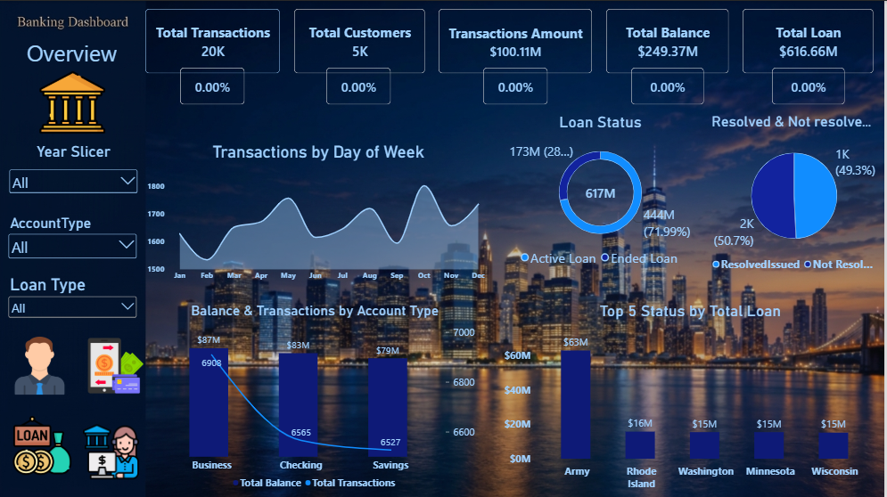
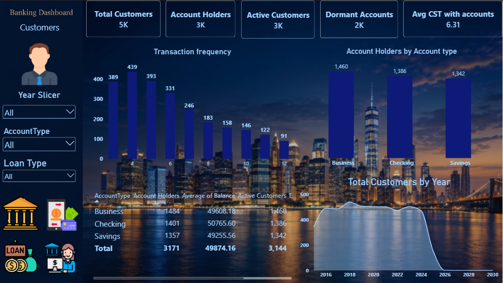
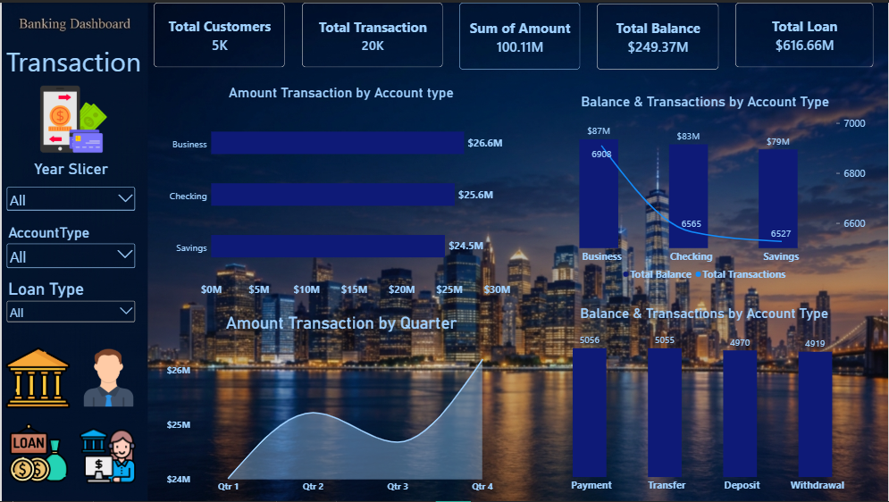
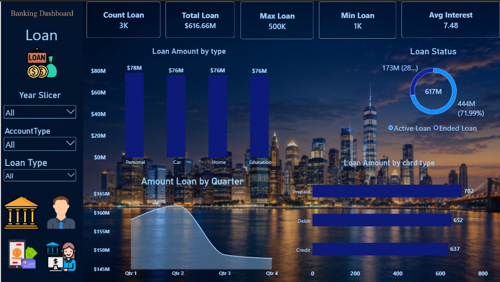
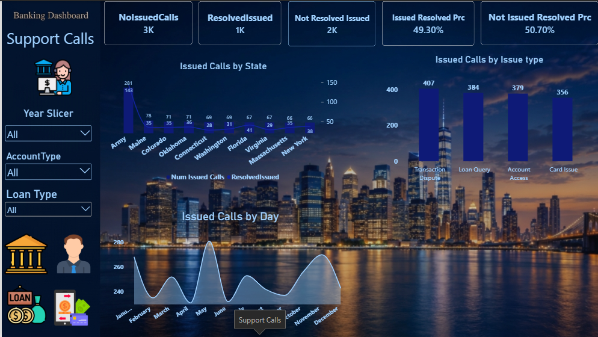

# Banking Customer & Operations Analytics

A comprehensive Power BI dashboard built to analyze bank customer behavior, operational performance, and key financial metrics.

---

## 📊 Demo & Overview
* **Video Demo (LinkedIn):** [Watch Dashboard Walkthrough](https://lnkd.in/p/eX5W-KMP)
* **Power BI File:** You can download the `.pbix` file directly from this folder to explore the data model, relationships, and DAX measures.

---

## 📸 Dashboard Preview

---

## 🛠️ Tools & Technologies Used
* **Power BI Desktop:** For data modeling, DAX calculations, and interactive visualizations.
* **Power Query:** For ETL (Extract, Transform, Load) processes and data cleaning.
* **Excel / CSV:** As the primary data source.
