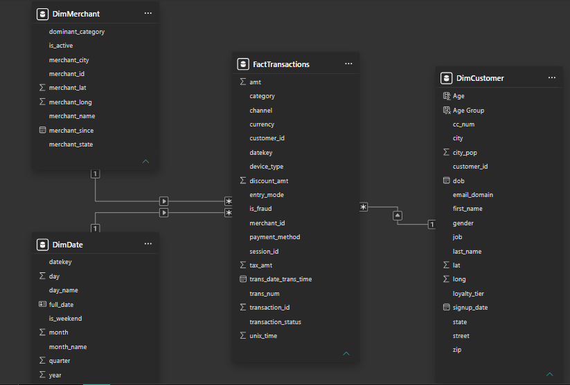
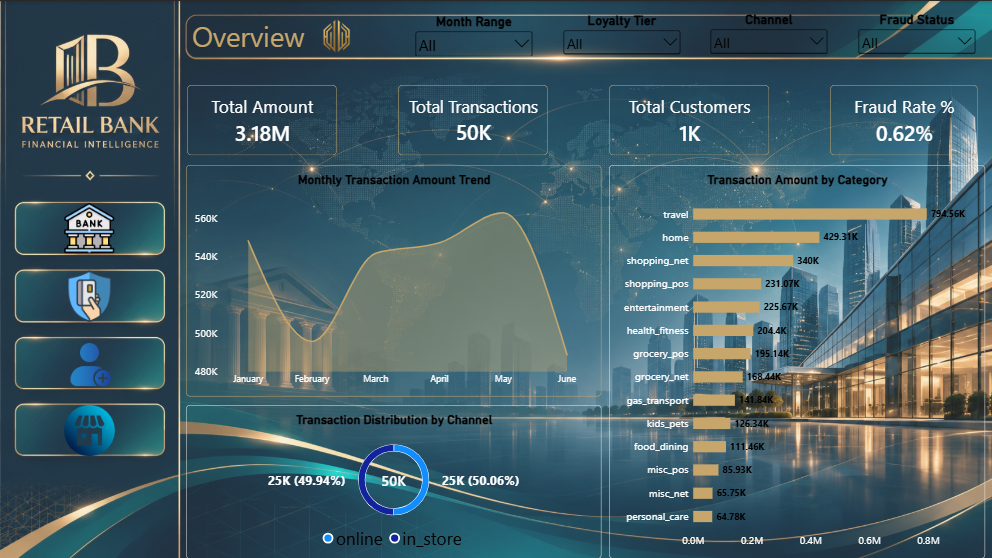
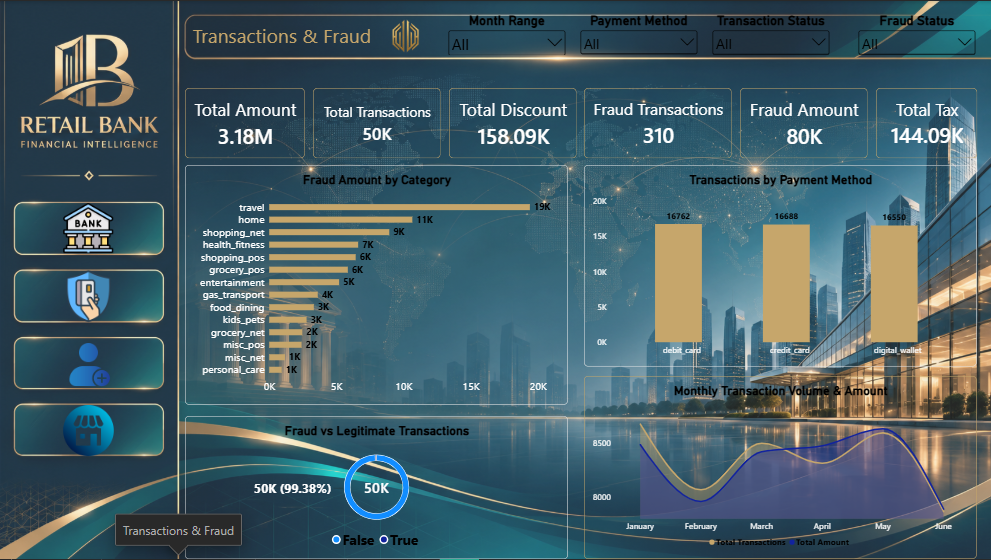
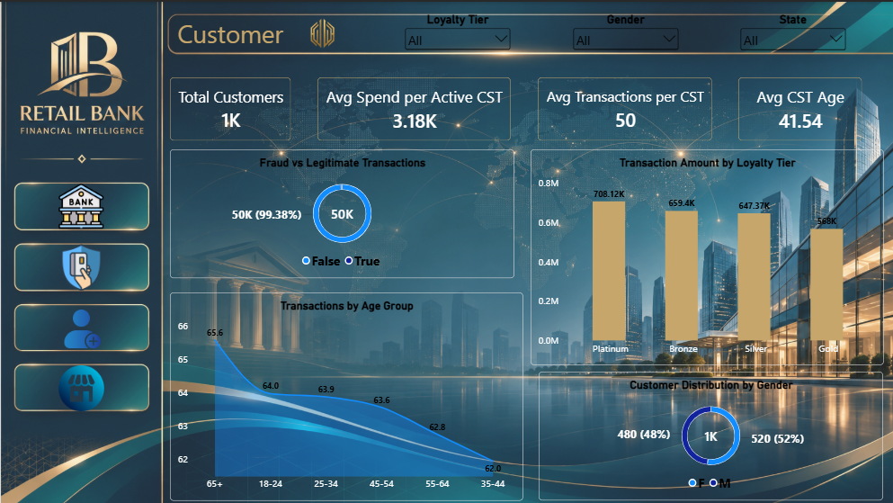
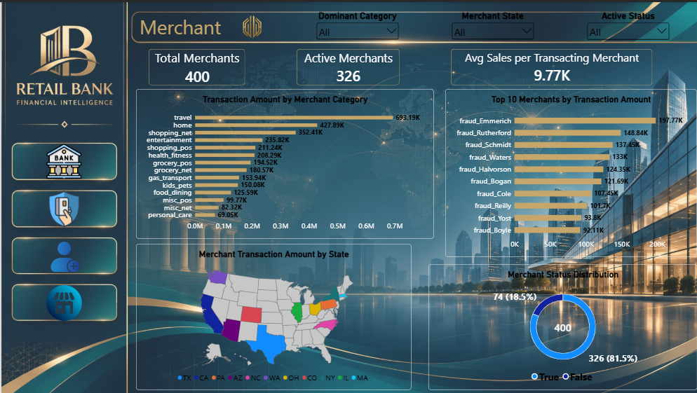

# RetailBank – Data Warehouse & Power BI Analytics

An end-to-end data warehouse using SQL Server, starting from raw CSV files and ending with an interactive Power BI dashboard.

---

## 📊 Demo & Overview
- **LinkedIn Post:** https://lnkd.in/p/eimqnFRU
- **SQL Scripts & Model:** Includes Bronze validation, Silver transformation, Gold star schema scripts, and schema diagram.
- **Power BI Report:** Connected to the Gold layer with a 4-page interactive dashboard.

---

## 📸 Architecture & Dashboard Preview

### Star Schema (Gold Layer)

### Dashboard Pages

---

## Data Warehouse & ETL Structure
- **Bronze Layer:** Raw CSV ingestion for Customers, Merchants, and Transactions preserving source fidelity.
- **Validation (`01_Validation_Bronze_Layer.sql`):** Checks for nulls/blanks, invalid casts (`TRY_CAST`), duplicates, categorical consistency, and orphan records.
- **Silver Layer (`02_Silver.sql`):** Data typing, text standardization, default values, boolean normalization, primary keys, and derived customer age.
- **Gold Layer (`03_Gold.sql`):** Star Schema modeling (`FactTransactions`, `DimDate`, `DimCustomer`, `DimMerchant`) with foreign keys and indexes.

---

## 🛠️ Tools & Technologies Used
- **SQL Server & SSMS:** For database creation, raw data import, and Star Schema modeling.
- **Power BI Desktop:** For DAX measures, data model relationships, and interactive reporting.
- **CSV Flat Files:** Raw operational source data for Customers, Merchants, and Transactions.
