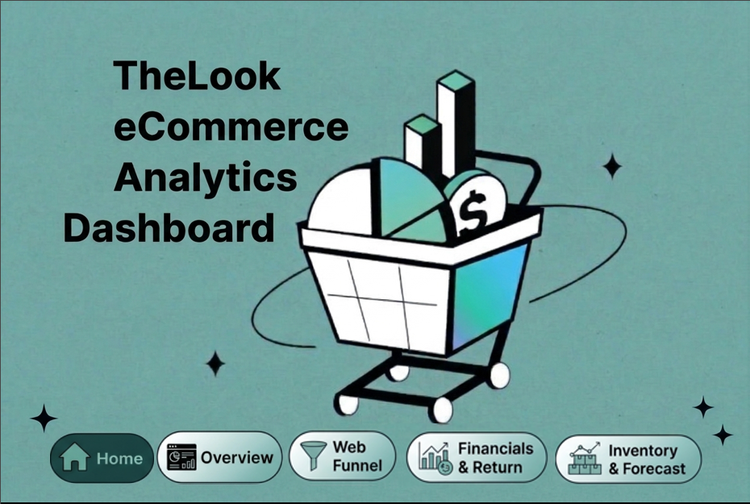
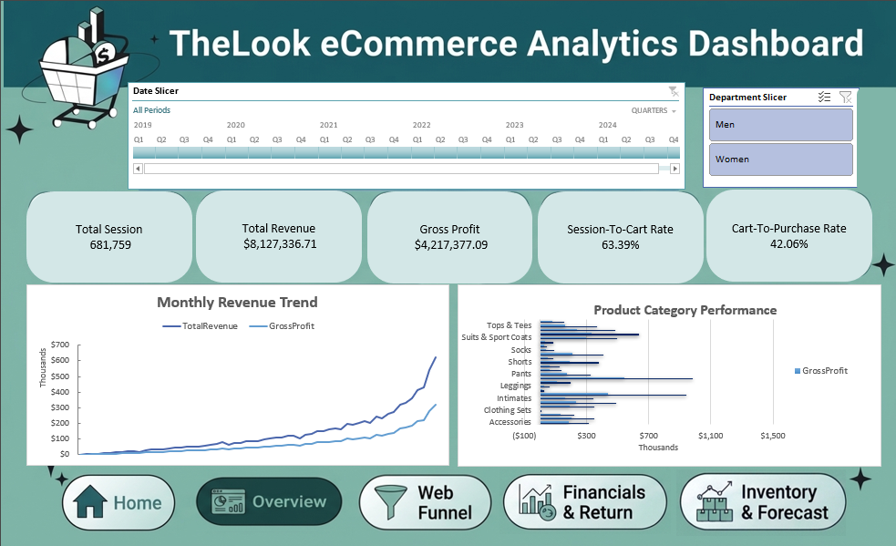
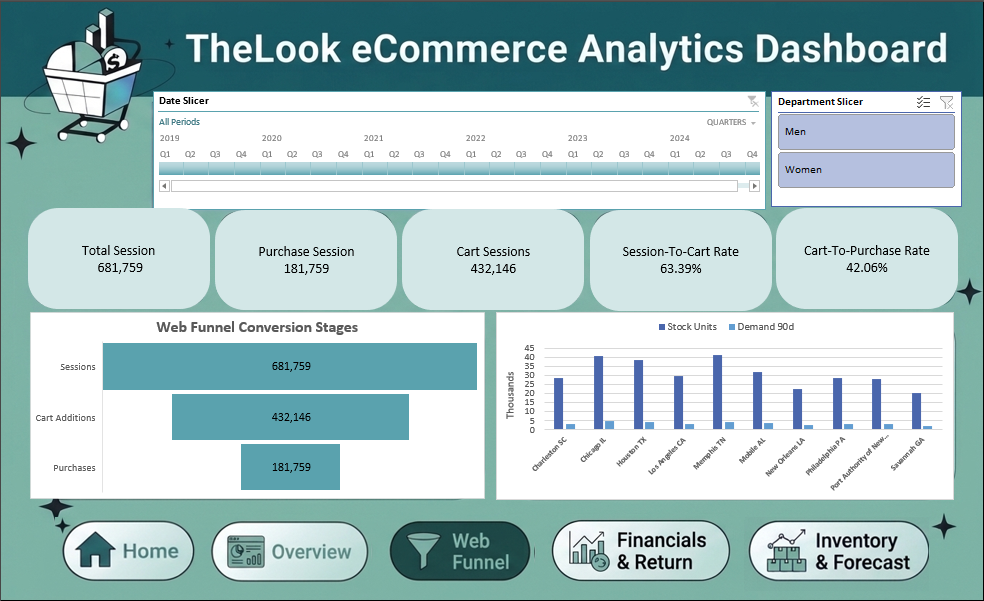

# TheLook eCommerce Analytics Dashboard

A comprehensive e-commerce data analytics and forecasting dashboard built using Excel and Power Query to track business performance, customer behavior, and inventory metrics.

## Overview

---

## Dashboard Preview

### 1. Home Page
> Introduction and navigation hub for the e-commerce dashboard.

### 2. Overview Page
> High-level summary of total sessions, revenue, gross profit, and monthly revenue trends.

### 3. Web Funnel Page
> Tracking user journey stages from initial sessions to cart additions and purchases, alongside traffic source conversions.

### 4. Financials & Return Page
> Deep dive into financial performance, profit margins, AOV, and return rates.

### 5. Inventory & Forecast Page
> Monitoring inventory stock units, distribution centers, and 90-day demand forecasts.

---

## Tools & Technologies Used

* **Excel:** As the primary platform for building interactive PivotTables, PivotCharts, and dashboards.
* **Power Query:** For ETL (Extract, Transform, Load) processes, data cleaning, and structuring the data model.
* **DAX / Advanced Formulas:** For calculating critical KPIs (Revenue, Profit Margins, Return Rates, AOV).

---

## Key Features & What I Worked On

* **Data Cleaning & ETL:** Processed raw e-commerce data using Power Query to ensure data integrity and schema structure.
* **Data Modeling:** Connected multiple relational tables to establish a robust schema.
* **KPI Tracking:** Built dynamic metrics to monitor revenue, profit, and return behavior.
* **Interactive Dashboards:** Implemented Slicers, PivotTables, and dynamic charts for seamless user exploration.
* **Forecasting:** Developed advanced trend forecasts to project future monthly revenue and inventory demands.
